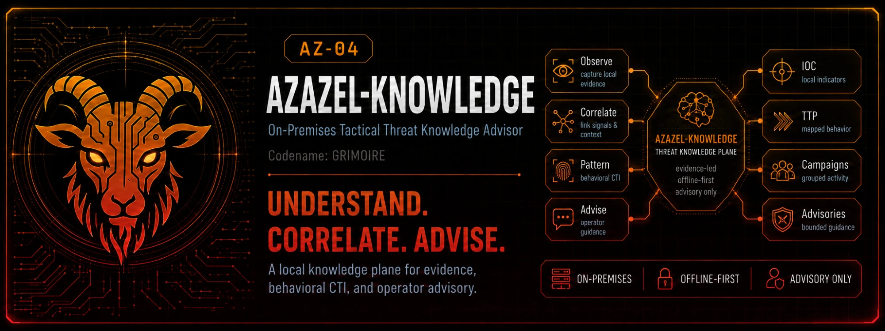

# AZ-04 Azazel-Knowledge - On-Premises Tactical Threat Knowledge Advisor

> **Codename:** `GRIMOIRE`



> **Formerly Azazel-CTI.** The formal series name is **Azazel-Knowledge Advisor**
> (**AZ-04**), ratified 2026-07-10; the `Advisor` Role suffix is used in
> formal/external contexts. The repository was renamed
> `01rabbit/Azazel-CTI` → `01rabbit/Azazel-Knowledge` (old URLs redirect).
> The codename `GRIMOIRE` follows the series convention (Edge: `SENTINEL`,
> Gadget: `TACMOD`): the accumulated book of threats — a grimoire never casts
> its own spells. Codenames are for changelogs and release names, never formal
> external naming.
> `Knowledge` is the class that accumulates and correlates IOC, ATT&CK, attacker
> reactions, and behavioral patterns — the series' Threat Knowledge Plane;
> `Advisor` returns evidence, confidence, history, and recommendations, never
> commands, and final authority stays with Azazel-Edge's deterministic arbiter.
> Likewise this node's generated Suricata/Sigma rules are drafts it never
> deploys. See [ADR-0001](docs/adr/0001-repository-naming.md).

**Status: implemented, under active development.** Phase 1 (single-site node:
ingest, IOC/JA3/JA4 search, deterministic `/v1/context`, reaction recording,
offline bundles, TAXII inbox) and the Phase 2 **Behavioral CTI** mechanism
([design](docs/design/phase2-implementation.md)) are on `main`. Phase 2's
multi-Edge scale-out is **not** complete (see [roadmap](docs/roadmap.md)).
Pi 4 performance and disk-encryption validation are **not yet measured** on
hardware. Test counts are not restated here; the single source of truth is
`CLAUDE.md` / `docs/development-guide.md` §0, enforced by
`tests/unit/test_claude_md_baseline.py`. The advisory-only, determinism, and
offline-first contracts are enforced by static and replay tests.

**Product version:** `azazel-knowledge` **0.1.0** (`pyproject.toml`); no release
tag is published. Requires Python ≥ 3.11. Boundary dependency:
`azazel-fabric` **`v0.9.0rc5`** (pre-release, `api` extra only;
[ADR-0019](docs/adr/0019-fabric-pin-v0-9-0rc5.md)). Compatibility with a given
Azazel-Edge release is not verified in this repository; the Edge payload contract
is tracked in [Azazel-Edge#305](https://github.com/01rabbit/Azazel-Edge/issues/305).

## Quick start (local validation)

These commands run from a repository checkout and do not touch any node data:

```sh
python3 -m venv .venv && source .venv/bin/activate
pip install -e ".[api,dev]"        # CI's install; fetches the Fabric pin from GitHub
python -m pytest tests/unit -q     # unit suite; must be fully green
python azctl check-config --config-dir config   # weights sum to 1.0, prints config_hash
python tools/docs-sync-check.py    # documentation drift check
```

- Runtime core needs only `pip install -e .` (PyYAML, idna, PyNaCl). The `api`
  extra (FastAPI/pydantic/uvicorn + the Fabric pin) is required for the HTTP
  service and boundary validation; it is never a core dependency.
- Installing the `api` extra needs GitHub access; the query path needs no
  internet access at runtime.
- Deploying a node (Pi 4, Docker Compose, `azctl provision`) is an operator
  task: see [docs/operations.md](docs/operations.md). `provision` prints the
  first API token once; store it securely.

Azazel-Knowledge is an independent, on-premises Cyber Threat Intelligence node built
on a portable Raspberry Pi 4. It pairs with
[Azazel-Edge](https://github.com/01rabbit/Azazel-Edge) (AZ-01) but is
deliberately a separate device and a separate repository.

The CTI node does **not** defend anything. It is a *device that understands
threats* — a Threat Knowledge Plane for the Azazel family:

- Operates fully on-premises; internet access is optional, used only to
  refresh threat feeds (MITRE ATT&CK, CVE/NVD, CISA KEV, abuse feeds, ...).
- Operates fully offline in the field; feeds can be updated via USB/SSD/LAN
  bundle transfer.
- Improves Azazel-Edge decision quality without degrading its real-time path.
- Turns delaying defense into a CTI sensor: attacker reactions under friction
  (throttle, redirect, isolate, deception) become structured intelligence.
- **Behavioral CTI (Phase 2):** compiles those reactions into evidence-backed
  behavior patterns, scores their similarity and repeatability, and returns
  them to Edge as *advisory* behavioral context — never a command, never a
  claim of AI attribution.

## The one rule that shapes everything

**The CTI node never commands.** It returns *threat context, confidence,
reasons, and recommendations* — advisory data only. Final authority always
stays with the Azazel-Edge Deterministic Arbiter. Azazel-Edge must remain
fully functional when the CTI node is absent, slow, or wrong.

## System overview

```
              Internet (optional)
                     │
             Threat feed update            offline: USB / SSD / LAN bundle
                     │
      ┌──────────────────────────────┐
      │  Raspberry Pi 4              │
      │  Azazel-Knowledge (AZ-04)     │   Intelligence / Correlation /
      │  Threat Knowledge Plane      │   Campaign analysis / IOC management /
      │                              │   Behavioral CTI (patterns, similarity)
      └──────────────────────────────┘
               ▲            │
   Evidence    │            │  Threat context (advisory)
   (EVE, DNS,  │            │  confidence / reason / ATT&CK /
   JA3/JA4,    │            │  recommended action + alternatives /
   flows,      │            │  behavioral_cti (seen-before, posture suggestion)
   delay hist, │            ▼
   reactions)  │
      ┌──────────────────────────────┐
      │  Raspberry Pi 5              │
      │  Azazel-Edge (AZ-01)         │   Detection / Delay / Deception /
      │  Decision Plane              │   Local decision / Local logging
      └──────────────────────────────┘
                     │
              Protected network
```

## Behavioral CTI (Phase 2)

Behavioral CTI is a **separate, additive lane** beside the Phase 1 scoring
envelope — it never touches the frozen `threat_score` / `reason[]` / replay
contract ([design](docs/design/phase2-implementation.md),
[ADR-0009](docs/adr/0009-behavioral-cti.md)):

- **Patterns** — immutable `reaction` rows (+ linked observations) are compiled
  deterministically into rebuildable `behavior_pattern` rows in `local.db`,
  every one traceable to raw evidence. Regeneration is atomic via a
  `behavior_generation` swap.
- **Classification** — config-versioned mapping into six behavior classes
  (`simple_scanner`, `scripted_automation`, `adaptive_probe`, `decoy_engaged`,
  `disengaged_after_friction`, `unknown`). Never an attribution label.
- **Similarity & repeatability** — deterministic, explainable, precomputed
  offline (no ML, no query-time computation).
- **Advisory** — `/v1/context` gains an optional, best-effort
  `threat_context.behavioral_cti` block (a *posture suggestion*, never a
  command); its absence never blocks or errors an answer.
- **Operator surfaces** — `GET /v1/behavior-patterns/*` and
  `/v1/reports/friction-timeline` plus `azctl behavior report` render the
  observe → track → classify → advise narrative.
- **Shadow scoring** *(experimental)* — research-only, default-off, shadow-only
  hooks whose `shadow_score_delta` never reaches `threat_score`, the `/v1/context`
  response, or `reason[]`; output goes to a JSONL research log alone.

**What Phase 2 does not yet include:** the multi-Edge scale-out. Cross-edge
linkage is partly implemented, but whether the actor at one Edge is the actor at
another is not yet inferred by Knowledge
([ADR-0018](docs/adr/0018-cross-edge-actor-inference.md)).

**Non-attribution doctrine:** Behavioral CTI characterizes adaptive or
automation-like behavior. It does not prove that an attacker used AI.

## Inputs and boundaries

Edge-facing endpoints (full contract in [api.md](docs/api.md)):

- **Evidence in:** `POST /v1/events` (EVE, DNS, HTTP, JA3/JA4, canary hits),
  `POST /v1/flows`, `POST /v1/reactions` (delay history and observed reaction).
- **AZ-06 deception:** `POST /v1/deception-observations` and
  `POST /v1/deception-outcome-envelopes` accept **fact-only** observations and
  coverage/limitations ([ADR-0011](docs/adr/0011-deception-observation-ingest.md)).
  Knowledge never activates a package, selects a host or tier, or commands
  deception. Deception runs only what Azazel-Edge has approved.
- **Edge engagement and outcomes:** `POST /v1/engagement-events` (what Edge
  selected and observed) and `POST /v1/outcome-evidence` (Fabric
  Outcome-as-Evidence records) are validated at the boundary and stored as
  evidence.
- **TAXII 2.1 inbox:** accepts STIX bundles pushed by Azazel-Edge. Outbound
  TAXII collections for upstream sharing are Phase 4 (future work).
- **Feeds (pulled, optional internet):** MITRE ATT&CK, CISA KEV, abuse.ch
  and other reference feeds, and signed offline bundles. The adapters are in
  `src/azazel_knowledge/feeds/adapters/`.

Boundaries:

- Azazel-MIO owns common cross-product reasoning and advice, while Knowledge provides verified facts, reference data, and advisory context; this main has no direct MIO runtime connection.
- Fabric is the shared contract at the boundary (see above); it does not
  decide anything.
- Azazel-Edge's deterministic arbiter remains the final authority.

**Experimental / unverified:** EPSS exploit-probability ingest is a
*proposed* design ([ADR-0014](docs/adr/0014-epss-advisory-ingest.md)) with no
adapter in the code; shadow scoring is default-off research; Pi 4 performance
gates and LUKS/Adiantum disk encryption are not yet verified on hardware
([issue #21](https://github.com/01rabbit/Azazel-Knowledge/issues/21)).

## Relationship to Azazel-Edge roadmap

This repository is the concrete home for the post-2026 research items tracked
in [Azazel-Edge #283](https://github.com/01rabbit/Azazel-Edge/issues/283):

| #283 research item | Where it lands here |
|---|---|
| Tactical CTI Sensor extension | Attacker-reaction store ([data model](docs/data-model.md)); Edge payload contract [Azazel-Edge#305](https://github.com/01rabbit/Azazel-Edge/issues/305) |
| Tactical Pattern Memory | Pattern store + deterministic Behavioral CTI generator ([architecture](docs/architecture.md), [Phase 2 design](docs/design/phase2-implementation.md)) |
| Richer correlation / knowledge model | Correlation engine, historical observation DB, behavioral similarity |
| External SOC/SIEM integration | STIX 2.1 / TAXII 2.1 inbox from Azazel-Edge is implemented here; outbound collections are Phase 4 (future work) |

Research framing: **"How does CTI optimize delaying defense?"** — not
"a lightweight CTI platform." See [ADR-0008](docs/adr/0008-research-theme.md).

## Azazel series context

Azazel-Knowledge (**AZ-04**, codename `GRIMOIRE`; formerly Azazel-CTI — formal
series name **Azazel-Knowledge Advisor**, ratified in
[ADR-0001](docs/adr/0001-repository-naming.md)) is one product of the
**Azazel** series ("Cyber Scapegoat Gateway"). The series map, AZ
designations, and naming specification live in the umbrella repository:
[01rabbit/Azazel](https://github.com/01rabbit/Azazel).

Knowledge-local integration note: this repository adopts
[`azazel_fabric.cti_contracts`](https://github.com/01rabbit/Azazel-Fabric)
at its API boundary
([ADR-0010](docs/adr/0010-adopt-fabric-cti-contracts.md)), tag-pinned as an
`api`-extra-only dependency; the **pin in force is `v0.10.0` (stable)**
([ADR-0023](docs/adr/0023-fabric-pin-v0-10-0.md),
carried in `pyproject.toml`) — ingest can be
type-enforced against the canonical `Cti<Kind>Batch` envelope, and every
`/v1/context` response is checked against Fabric's directive-field validator
before it is emitted (fail-closed). The adoption is additive, wire shapes are
unchanged, and **there is still no core dependency**: Fabric is imported only
under `azazel_knowledge.api`; the core dependency set (stdlib + PyYAML + idna
+ PyNaCl) is untouched, per this repo's dependency-minimality constraint.

## Documentation

- [Architecture](docs/architecture.md) — planes, components, data flows, failure modes
- [Data model](docs/data-model.md) — IOC, ATT&CK, campaign, observation, pattern, behavioral stores
- [API](docs/api.md) — Edge-facing REST contract, behavioral advisory, query discipline
- [Scoring](docs/scoring.md) — deterministic, explainable confidence; shadow reaction-informed scoring
- [Sync and offline operation](docs/sync-offline.md) — feed adapters, signed offline
  bundles, and **Knowledge Lite**: a bounded, deterministic, full-only profile of that
  bundle for Azazel-Nexus/Azazel-Boot ([ADR-0015](docs/adr/0015-knowledge-lite-bundle.md),
  [ADR-0017](docs/adr/0017-lite-is-full-only.md))
- [Operations](docs/operations.md) — provisioning, feeds, connecting an Edge, behavioral generation
- [Roadmap](docs/roadmap.md) — scaling phases and the CTI-optimized-delay research loop
- [Development guide](docs/development-guide.md) — the commander/adversarial-reviewer + Codex delegation loop
- [Design records](docs/design/) — Phase 1 and Phase 2 implementation designs
- [Decision records](docs/adr/) — resolved design questions with rationale
- [Contributing](CONTRIBUTING.md) — branch/commit conventions, PR gate, delegation rules
- [Security policy](SECURITY.md) — vulnerability reporting and scope

## Non-goals

- Not a defense device: no packet forwarding, no blocking, no enforcement.
- Not an autonomous analyst: LLM use (if any) is limited to explanation and
  report generation, never verdicts.
- Not a cloud TIP replacement: single-site, constrained-hardware, offline-first.
- Not authoritative over Azazel-Edge: advisory output only, by contract.
- Not an AI-attribution engine: it names adaptive/automation-like behavior,
  never a proof of AI usage.

## Target hardware

Raspberry Pi 4 (8 GB RAM board; design budget under 2 GB resident for API +
workers), SSD boot, Gigabit Ethernet, Docker Compose, optional UPS. The
reference profile is in [ops/hardware-profile.md](ops/hardware-profile.md); the
resource budget is in [architecture](docs/architecture.md#resource-budget).
Measured results on the real Pi 4 are pending (see *Experimental / unverified*).
